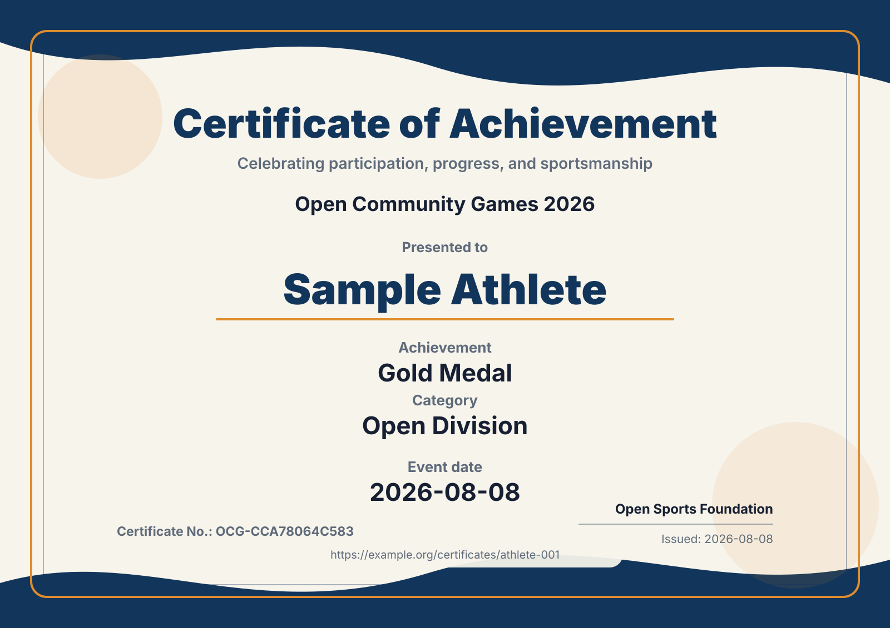

# 体育赛事证书生成器

[](https://github.com/chenyunfeng0630-max/sports-event-certificate-generator/actions/workflows/ci.yml)
[](https://github.com/chenyunfeng0630-max/sports-event-certificate-generator/actions/workflows/codeql.yml)
[](LICENSE)

[English](README.md) | **简体中文**

一个隐私优先的 TypeScript 工具包与命令行程序，用 CSV 或 JSON 校验并批量生成可访问、可核验的体育赛事 SVG 证书。证书编号可重复计算；文件名、清单、控制台日志和匿名使用报告不会包含获奖者姓名。



## 项目解决什么问题

社区体育赛事经常依赖人工制证，或者把包含大量个人信息的表格直接交给临时脚本。本项目提供可复用、风险更低的基础能力：

- 确定性证书编号，同一数据重复运行不会产生不同编号；
- 支持英文和简体中文；
- 运行时零第三方依赖，输出便携 SVG；
- 自动进行 XML 转义和 HTTPS 核验链接校验；
- 主动拒绝手机号、邮箱、地址、身份证号、密码、Token 和 Secret 等字段；
- 文件名、清单和控制台不写入获奖者姓名；
- 支持 JSON 输入，以及不生成证书文件的 `validate` 和 `--dry-run`；
- 匿名使用报告只含数量与赛事指纹，不含姓名、参与者编号或赛事名称；
- 默认禁止覆盖已有文件；
- 包含自动化测试、CI、CodeQL 和敏感信息检查。

## 快速开始

需要 Node.js 20 或更高版本。

```bash
npm install
npm run verify
npm run example
```

示例会在 `examples/output/` 生成两张完全虚构的证书。

使用自己的数据：

```bash
npm run build
node dist/src/cli.js generate \
  --input ./participants.csv \
  --config ./config.json \
  --out ./generated
```

只校验、不生成证书文件：

```bash
node dist/src/cli.js validate \
  --input ./participants.json \
  --config ./config.json \
  --report ./usage-report.json
```

也可以使用 `generate --dry-run`。如果连匿名报告文件也不希望写入，则省略 `--report`。

## CSV 格式

必填字段：

| 字段 | 含义 |
| --- | --- |
| `recipientId` | 不敏感的匿名编号，例如 `athlete-001`；不能使用手机号、邮箱或身份证号 |
| `recipientName` | 显示在证书上的姓名 |
| `achievement` | 奖项、名次、完赛或表彰文字 |

可选字段：`category`、`eventDate`、`verificationUrl`。

```csv
recipientId,recipientName,achievement,category,eventDate,verificationUrl
athlete-001,示例运动员,体育精神奖,青少年组,2026-08-08,https://example.org/certificates/athlete-001
```

## JSON 格式

JSON 输入是一个数组，字段要求与 CSV 相同：

```json
[
  {
    "recipientId": "athlete-001",
    "recipientName": "示例运动员",
    "achievement": "金牌",
    "category": "青少年组"
  }
]
```

未知字段会被拒绝，避免误把完整报名表及其额外个人信息传给生成器。

## 匿名使用报告

在 `validate`、`generate --dry-run` 或 `generate` 后添加 `--report usage-report.json`。报告只记录工具版本、汇总数量、输入格式、是否写出证书和确定性的赛事指纹；不会记录赛事名称、参与者姓名、参与者编号或证书内容。

## 配置文件

```json
{
  "eventName": "2026 开放社区运动会",
  "issuer": "开放体育基金会",
  "title": "荣誉证书",
  "subtitle": "记录参与、进步与体育精神",
  "issueDate": "2026-08-08",
  "locale": "zh-CN",
  "idPrefix": "OCG",
  "namespace": "open-community-games-2026",
  "theme": {
    "primary": "#12355b",
    "accent": "#e08d2d",
    "background": "#f7f4ec"
  }
}
```

`theme` 还支持 `text`、`muted`、`fontFamily`、`width` 和 `height`。

## 隐私与安全

生成器只接受制证所必需的字段。不要把证件号码、手机号、邮箱、家庭住址、医疗信息、账号凭证或 API Key 放入源码、CSV、清单、Issue 或 PR。

姓名本身仍属于个人信息。除非参与者明确同意公开，否则输入 CSV 和生成证书应保存在受控环境中。详见[隐私设计](docs/privacy.md)和[安全政策](SECURITY.md)。

## 当前状态

`v0.2.0` 新增 JSON 输入、无输出校验与匿名汇总使用报告。在 `v1.0.0` 前 API 仍可能调整，但确定性编号和隐私保护会保持为核心兼容目标。参见[路线图](ROADMAP.md)、[更新记录](CHANGELOG.md)与[采用指南](docs/adoption.md)。

`v0.2.0` 候选包已使用受保护的真实赛事记录完成一次[维护者私密试运行](docs/case-studies/maintainer-private-pilot-2026-08.md)，共校验并生成 251 份证书。它属于维护者证据，不代表外部采用。

## 参与贡献

欢迎提交 Issue、真实使用反馈和 Pull Request。请先阅读 [CONTRIBUTING.md](CONTRIBUTING.md)，使用 adopter feedback 表单时不要附加参与者数据，并遵守[社区行为准则](CODE_OF_CONDUCT.md)。

## 许可证

[MIT](LICENSE)。本项目不包含任何私有生产数据、机构 Logo、官方印章、赛事美术素材或专有证书模板。
